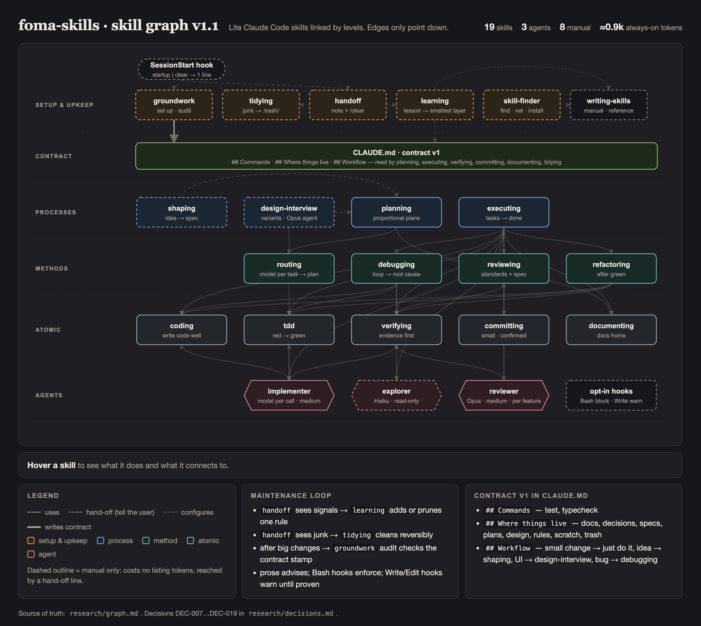

# foma-skills

Basic, lightweight skills for Claude Code. They take an idea from first question to merged commit and keep the workspace clean, with as little always-on token cost as possible.

> **Status: pre-release.** The structure is in place; skills are being written and tested (stage 6). Nothing below is installable as a working skill yet.



Interactive version: [`docs/graph.html`](docs/graph.html).

## Install

```
/plugin marketplace add foma/foma-skills
/plugin install foma-skills@foma
```

Skills are namespaced: `/foma-skills:<skill>`. Plugins are the only supported install.

## Skills

Manual skills run only when you call them; model skills fire on their own when the task fits.

| Group | Skill | Trigger | What it does |
|-------|-------|---------|--------------|
| Setup & upkeep | `groundwork` | manual | Set up or audit a project: safety, CLAUDE.md contract, docs structure, session-start token cost, opt-in hooks |
| | `tidying` | manual | Find junk by tier, report first, remove reversibly |
| | `learning` | manual | Turn session lessons into the smallest fix (CLAUDE.md line, rule, hook, project skill); prune stale rules |
| | `skill-finder` | manual | Find, vet, install and register a third-party skill safely |
| | `handoff` | manual | Write a session note before `/clear`; the next session picks it up |
| Ideas & design | `shaping` | manual | Question an idea until it becomes a spec |
| | `design-interview` | manual | Interview about the look, show 2–4 variants side by side, record the choice |
| Build | `planning` | model | Proportional plan: small change → just do it; multi-step → task files |
| | `executing` | model | Run plan tasks, review once per feature, archive the plan |
| | `routing` | model | Pick a model and effort per plan task |
| Methods | `debugging` | model | Reproduce → hypothesis → fix + regression test |
| | `reviewing` | model | Review against standards and the spec, compact verdict |
| | `refactoring` | model | Behaviour-preserving change after tests are green |
| Atomic | `coding` | model | Writing-code rules: simplest solution, touch only what's needed, no fake fallbacks |
| | `tdd` | model | Test-first in vertical slices |
| | `verifying` | model | Evidence per change type, failing tests only, "not checked" line |
| | `committing` | model | Small commits in the project's style; never pushes on its own |
| | `documenting` | model | Keep docs and decision records in their home |
| Meta | `writing-skills` | manual | Write a skill to the lite standard |

## How it is built

- Every skill follows the [lite standard](docs/lite-standard.md): short core, details in references read only when needed, token caps checked in CI.
- The whole research history is open in [`research/`](research/): sources, facts, candidates, decisions (`research/decisions.md`) and the log.
- Third-party work is credited in [`CREDITS.md`](CREDITS.md).

## Contributing

See [`CONTRIBUTING.md`](CONTRIBUTING.md).

## License

[Apache-2.0](LICENSE). Copyright 2026 Vladislav Fomin (foma); see [`NOTICE`](NOTICE).
