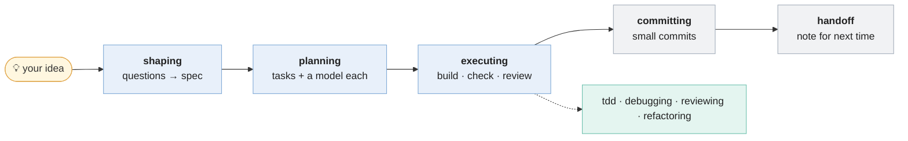
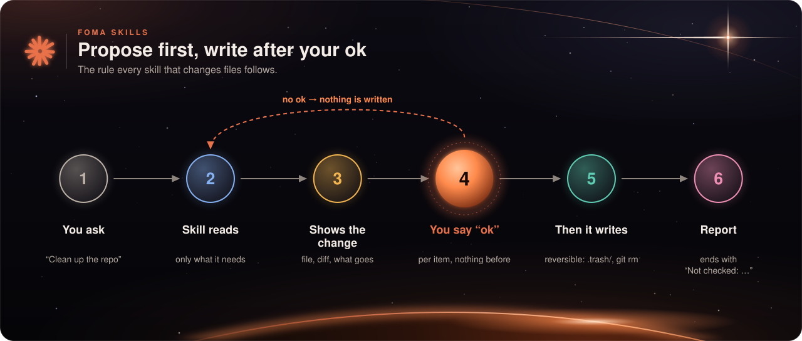

<div align="center">


**English** · [Русский](README.ru.md)

[](https://github.com/t8jwscc7qy-sketch/foma-skills/actions/workflows/validate.yml)


[](LICENSE)

### Say what you want. The right skill wakes up, asks first, and does the careful part.

[🚀 Install](#install) · [✨ What you get](#what-you-get) · [🧭 First 5 minutes](#first-5-minutes) · [🧰 All skills](#skills) · [🇷🇺 Документация на русском](docs/ru/quickstart.md)

</div>

> [!NOTE]
> **New to skills?** A *skill* is a short instruction file that Claude loads only when your request matches it. Without skills Claude improvises every time; with them it follows a proven routine (plan, test first, small commits) and asks before it changes anything important.

<a id="install"></a>
## 🚀 Install

In Claude Code, run two commands:

```
/plugin marketplace add t8jwscc7qy-sketch/foma-skills
/plugin install foma-skills@foma
```

Then **restart Claude Code in your project** (the plugin loads when a session starts) and just talk to it. Nothing else to configure.

> [!TIP]
> Try it on a small or throwaway project first. To remove it: `/plugin uninstall foma-skills@foma`. Install only for one project with `--scope local` (`claude plugin install foma-skills@foma --scope local`).

<a id="what-you-get"></a>
## ✨ What you get

| 🪶 **Light** | 🛡️ **Careful** |
|---|---|
| Only short skill descriptions (≈1.4k tokens) are always in context. A skill's full text loads only when it fires, so your limits go to your work. | Skills **propose first and write after your ok**. Nothing is pushed on its own, files are removed reversibly, third-party skills are vetted before install. |
| 🧪 **Tested** | 🔓 **Open** |
| Every skill passes static checks, trigger tests and a smoke run. Failures and fixes are logged honestly in [`research/`](research/). | Apache-2.0. The whole research history, decisions and test ledger are public. |

<a id="first-5-minutes"></a>
## 🧭 Your first 5 minutes

You do not call skills by name. You describe the work, and the matching skill wakes up (illustrative session):

```text
You:     I want to build a loyalty points system for the shop.
Claude:  [shaping] Before I write anything: how do customers earn points, and can they expire?
You:     ...answers...                      -> an approved spec in docs/specs/
You:     Make a plan.
Claude:  [planning] 4 tasks in docs/plans/loyalty/plan.md, each with a check and a model.
You:     Execute the plan.
Claude:  [executing] runs the tasks, checks each one, one review at the end.
You:     Commit my changes.
Claude:  [committing] small commits in your style, only the files it changed. It does not push.
You:     Wrap up, I'll continue tomorrow.
Claude:  [handoff] saves a short note; the next session starts with "Next: ...".
```

You can also call any skill by hand: `/foma-skills:planning`, `/foma-skills:tidying`, ...

<a id="how-a-task-flows"></a>
## 🔄 How a task flows




<a id="skills"></a>
## 🧰 All 17 skills

Say something like the example in the third column. **auto** = fires on its own when the task fits, **manual** = you call it.

### 🟠 Setup and upkeep

| Skill | Mode | Say something like | What it does |
|---|---|---|---|
| `groundwork` | auto | "Set up this project for Claude" | Sets up or audits a project: safety, a short `CLAUDE.md` contract, docs layout, helper agents. Writes after your ok. |
| `tidying` | auto | "The repo is messy, clean it up" | Finds junk by tier, shows a report, removes reversibly (`.trash/` or `git rm`). |
| `learning` | auto | "You keep forgetting X, make it a rule" | Turns a repeated mistake into the smallest lasting fix and prunes stale rules. Proposes first. |
| `skill-finder` | auto | "Is there a skill for release notes?" | Finds a third-party skill, vets every file, installs only after your ok. |
| `handoff` | auto | "Wrap up, I'll continue tomorrow" | Writes a short session note so the next session resumes in one step. |

### 🔵 Ideas, design and build

| Skill | Mode | Say something like | What it does |
|---|---|---|---|
| `shaping` | auto | "I want to build a loyalty points system" | Questions a raw idea until it becomes an approved spec. |
| `design-interview` | auto | "I need a new look for the settings screen" | Shows three different variants side by side in the browser and records your pick in `DESIGN.md`. |
| `planning` | auto | "Make a plan for the refunds feature" | Breaks work into ordered, checkable tasks and picks a model and effort per task. Small change: no plan needed. |
| `executing` | auto | "Execute the plan" | Runs the plan task by task with checks, one review per feature, archives the plan. |

### 🟢 Methods

| Skill | Mode | Say something like | What it does |
|---|---|---|---|
| `debugging` | auto | "Why does checkout throw an error?" | Reproduce, form a hypothesis, find the root cause, then fix with a regression test. |
| `reviewing` | auto | "Review my branch, is it ready to merge?" | Reviews against your standards and the spec, ends with ship or fix-first. |
| `refactoring` | auto | "Refactor report.py, remove the duplication" | Changes structure, never behaviour, only after tests are green. |

### ⚪ Atomic

| Skill | Mode | Say something like | What it does |
|---|---|---|---|
| `tdd` | auto | "Add the discount rule test-first" | Red-green slices with independent expected values. |
| `committing` | auto | "Commit my changes" | Small commits in your project's style; never pushes on its own. |
| `documenting` | auto | "Record the decision to use Decimal" | Puts docs and decision records in their home. |

### 🟣 Meta

| Skill | Mode | Say something like | What it does |
|---|---|---|---|
| `writing-skills` | auto | "Write a skill for our release routine" | Writes or tightens a skill: short description, tight steps, tested triggers. |
| `tuning` | **manual** | `/foma-skills:tuning` | Reads the usage log and saved test runs, finds skills that never fire or keep failing, proposes the smallest fix. Spends tokens only on flagged skills. |

<details>
<summary><b>🕸️ How the skills connect</b> (diagram)</summary>



Interactive version: [`docs/graph.html`](docs/graph.html).

</details>


<a id="safe"></a>
## 🛡️ Safe by design



- **Propose first.** Skills that change files show the exact change and write only after your ok.
- **No surprise pushes.** `committing` never pushes on its own; destructive commands are not part of any skill.
- **Reversible cleanup.** `tidying` moves files to `.trash/` or uses `git rm`; it never runs `rm -rf`.
- **Vetted installs.** `skill-finder` reads every file of a third-party skill through a read-only agent, pins a commit and never passes `-y`.
- **Honest reports.** Each skill ends with what it did not check.

<a id="usage-log"></a>
## 📊 Usage log and privacy

A tiny hook counts which skills fire: skill name, UTC time and session id go to `.scratch/fires.jsonl` **in your project**. No prompt text is stored and nothing is sent anywhere. After about 20 sessions `/foma-skills:tuning` can show which skills never fired. Turn it off with the environment variable `FOMA_FIRE_LOG=off`, or delete the file.

<a id="cost"></a>
## 🪶 What it costs in tokens



Claude keeps every installed skill's name and one-paragraph description in context so it can pick one: about 80–90 tokens each, and the pack keeps descriptions short (≤250 characters). On top of that the session-start hook adds one short router line. A skill's full instructions (about 0.7–1.4k tokens) are read only when it fires, and long details live in reference files read only when needed. The ≈1.4k figure is Claude Code's own estimate; check it yourself with `claude plugin details foma-skills`.

<details>
<summary><b>🗑️ Skills that were tried and dropped</b></summary>

Rules the models already follow are not skills here. Tested on Haiku and Sonnet against a no-skill and a one-line baseline (DEC-025):

| Was | Result | Now |
|-----|--------|-----|
| `coding` (minimal scope, no fake fallbacks) | Fired on 5–6 of 10 code prompts; never fired in a long task; no gain over baseline | Rules in the `implementer` agent + one CLAUDE.md line |
| `verifying` (evidence before "done") | Fired on 7–8 of 10; no gain on short tasks; a one-line CLAUDE.md rule did as well (6/6) on the long task | Rules in `implementer`/`reviewer` + one CLAUDE.md line |

</details>


<a id="docs"></a>
## 📚 Documentation

| | |
|---|---|
| 🇷🇺 **Русская документация** | [Быстрый старт](docs/ru/quickstart.md) · [Справочник по скиллам](docs/ru/skills.md) · [Как это работает](docs/ru/how-it-works.md) · [FAQ](docs/ru/faq.md) |
| 📐 **Lite standard** | How every skill is written and checked: [`docs/lite-standard.md`](docs/lite-standard.md) |
| 🔬 **Research** | Sources, decisions and the test ledger: [`research/`](research/) |
| 🙏 **Credits** | Third-party work: [`CREDITS.md`](plugins/foma-skills/CREDITS.md) |

> [!IMPORTANT]
> **Status: pre-release (0.1.0).** All 17 skills pass static checks, trigger tests (the 16 automatic ones) and one smoke run each. Not done yet: the final eval against a no-pack baseline. The numbers in `research/` come from small samples; treat them as indicative, not proven.

## 🤝 Contributing

> 🎯 **A skill did not fire?** That is the most useful report you can send: [tell us the exact words you said](https://github.com/t8jwscc7qy-sketch/foma-skills/issues/new?template=skill_didnt_fire.yml).

Issues and pull requests are welcome; see [`CONTRIBUTING.md`](CONTRIBUTING.md). The pack stays small on purpose: a skill earns its place only if it beats a plain one-line instruction in tests.

## 📄 License

[Apache-2.0](LICENSE). Copyright 2026 Vladislav Fomin (foma); see [`NOTICE`](plugins/foma-skills/NOTICE).
