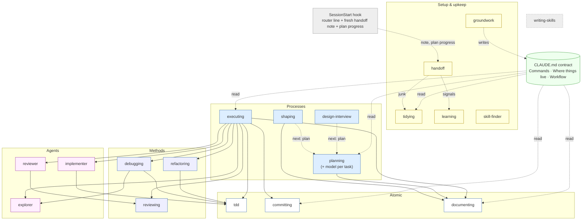

# foma-skills

Basic, lightweight skills for Claude Code. They take an idea from first question to merged commit and keep the workspace clean, with as little always-on token cost as possible.

> **Status: pre-release (0.1.0).** All 16 skills are written and pass static checks, trigger tests and one smoke run each. Not yet done: the final eval against a no-pack baseline, and a first CI run (the repo has no remote yet). Treat the numbers below as unproven until then.



Interactive version: [`docs/graph.html`](docs/graph.html).

## Install

```
/plugin marketplace add foma/foma-skills
/plugin install foma-skills@foma
```

Skills are namespaced: `/foma-skills:<skill>`. Plugins are the only supported install.

## Skills

Skills fire on their own when the task fits (a session hook routes them, DEC-031); you can always call one as `/foma-skills:<skill>`. Skills that change files only propose first and write after your ok.

A small hook counts skill calls locally: skill name, UTC time and session id go to `.scratch/fires.jsonl` in your project (never prompt text, nothing is sent anywhere). See which skills earn their place: `cut -d'"' -f8 .scratch/fires.jsonl | sort | uniq -c | sort -rn`; delete the file to reset.

| Group | Skill | Trigger | What it does |
|-------|-------|---------|--------------|
| Setup & upkeep | `groundwork` | model | Set up or audit a project: safety, CLAUDE.md contract, docs structure, session-start token cost |
| | `tidying` | model | Find junk by tier, report first, remove reversibly |
| | `learning` | model | Turn session lessons into the smallest fix (CLAUDE.md line, rule, hook, project skill); prune stale rules |
| | `skill-finder` | model | Find, vet, install and register a third-party skill safely |
| | `handoff` | model | Write a session note before `/clear`; the next session picks it up |
| Ideas & design | `shaping` | model | Question an idea until it becomes a spec |
| | `design-interview` | model | Interview about the look, show 2–4 variants side by side, record the choice |
| Build | `planning` | model | Proportional plan: small change → just do it; multi-step → task files with a model and effort per task |
| | `executing` | model | Run plan tasks, review once per feature, archive the plan |
| Methods | `debugging` | model | Reproduce → hypothesis → fix + regression test |
| | `reviewing` | model | Review against standards and the spec, compact verdict |
| | `refactoring` | model | Behaviour-preserving change after tests are green |
| Atomic | `tdd` | model | Test-first in vertical slices |
| | `committing` | model | Small commits in the project's style; never pushes on its own |
| | `documenting` | model | Keep docs and decision records in their home |
| Meta | `writing-skills` | model | Write a skill to the lite standard |

## Dropped after tests

Rules the models already follow are not skills here. Tested on Haiku and Sonnet against a no-skill and a one-line baseline (DEC-025):

| Was | Result | Now |
|-----|--------|-----|
| `coding` (minimal scope, no fake fallbacks) | Fired on 5–6 of 10 code prompts; never fired in a long task; no gain over baseline | Rules in the `implementer` agent + one CLAUDE.md line |
| `verifying` (evidence before "done") | Fired on 7–8 of 10; no gain on short tasks; a one-line CLAUDE.md rule did as well (6/6) on the long task | Rules in `implementer`/`reviewer` + one CLAUDE.md line |

## How it is built

- Every skill follows the [lite standard](docs/lite-standard.md): short core, details in references read only when needed, token caps checked in CI.
- The whole research history is open in [`research/`](research/): sources, facts, candidates, decisions (`research/decisions.md`) and the log.
- Third-party work is credited in [`CREDITS.md`](plugins/foma-skills/CREDITS.md).

## Contributing

See [`CONTRIBUTING.md`](CONTRIBUTING.md).

## License

[Apache-2.0](LICENSE). Copyright 2026 Vladislav Fomin (foma); see [`NOTICE`](plugins/foma-skills/NOTICE).
