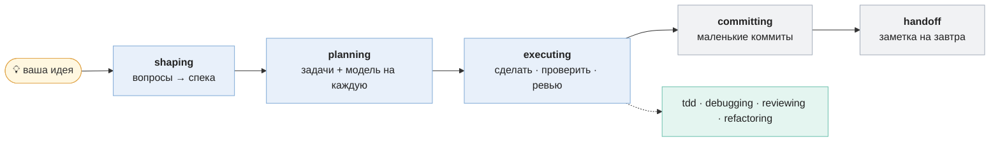
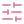
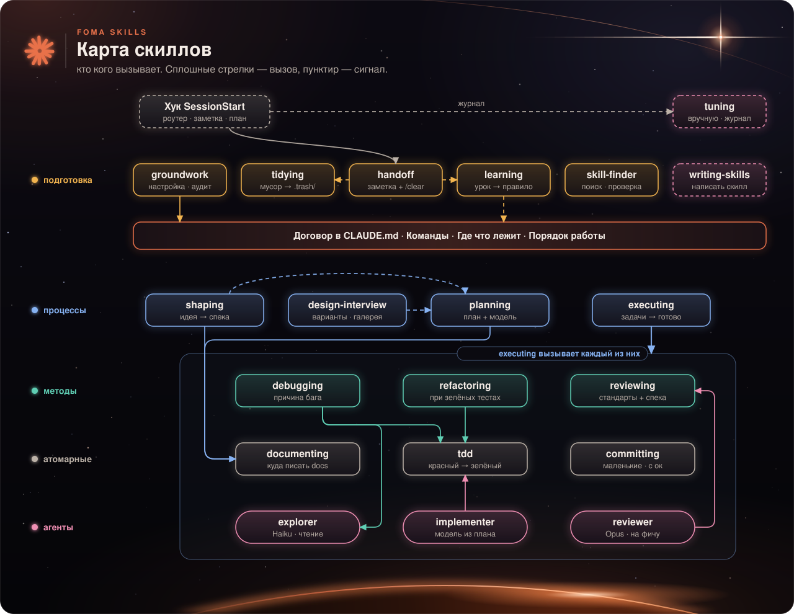

<div align="center">


[English](README.md) · **Русский**

[](https://github.com/t8jwscc7qy-sketch/foma-skills/actions/workflows/validate.yml)


[](LICENSE)

### Скажите, что нужно. Нужный скилл включится сам, сначала спросит и аккуратно сделает работу.

[🚀 Установка](#install) · [✨ Что вы получаете](#what-you-get) · [🧭 Первые 5 минут](#first-5-minutes) · [🧰 Все скиллы](#skills) · [📚 Подробная документация](docs/ru/quickstart.md)

</div>

> [!NOTE]
> **Впервые слышите про скиллы?** Скилл — это короткий файл с инструкцией, который Claude подгружает только тогда, когда ваш запрос ему подходит. Без скиллов Claude каждый раз импровизирует. Со скиллами он следует проверенному порядку (план, сначала тест, маленькие коммиты) и спрашивает, прежде чем менять что-то важное.

<a id="install"></a>
##  Установка

В Claude Code выполните две команды:

```
/plugin marketplace add t8jwscc7qy-sketch/foma-skills
/plugin install foma-skills@foma
```

Потом **перезапустите Claude Code в вашем проекте** (плагин подключается при старте сессии) и просто общайтесь как обычно. Больше ничего настраивать не нужно.

> [!TIP]
> Сначала попробуйте на небольшом или тестовом проекте. Удалить: `/plugin uninstall foma-skills@foma`. Установить только для одного проекта: `claude plugin install foma-skills@foma --scope local`.

<a id="what-you-get"></a>
##  Что вы получаете

| 🪶 **Лёгкость** | 🛡️ **Аккуратность** |
|---|---|
| В контексте постоянно лежат только короткие описания скиллов (≈1,4k токенов). Полный текст скилла загружается, только когда он срабатывает, так что лимиты уходят на вашу работу. | Скиллы **сначала предлагают и пишут после вашего «ок»**. Ничего не пушится само, файлы удаляются обратимо, чужие скиллы проверяются перед установкой. |
| 🧪 **Проверенность** | 🔓 **Открытость** |
| Каждый скилл прошёл статические проверки, тесты срабатывания и смоук-прогон. Провалы и исправления честно записаны в [`research/`](research/). | Лицензия Apache-2.0. Вся история исследования, решения и журнал тестов публичны. |

<a id="first-5-minutes"></a>
##  Первые 5 минут

Скиллы не нужно вызывать по имени. Вы описываете работу, и подходящий скилл просыпается (пример сессии, приблизительный):

```text
Вы:      Хочу сделать систему бонусных баллов для магазина.
Claude:  [shaping] Прежде чем писать код: как покупатели получают баллы, и сгорают ли они?
Вы:      ...отвечаете...                    -> утверждённая спека в docs/specs/
Вы:      Составь план.
Claude:  [planning] 4 задачи в docs/plans/loyalty/plan.md, у каждой проверка и модель.
Вы:      Выполняй план.
Claude:  [executing] делает задачи по одной, проверяет каждую, в конце одно ревью.
Вы:      Закоммить мои изменения.
Claude:  [committing] маленькие коммиты в стиле проекта, только свои файлы. Не пушит.
Вы:      Завершаем, продолжу завтра.
Claude:  [handoff] сохраняет короткую заметку; новая сессия начнётся с «Next: ...».
```

Любой скилл можно вызвать и вручную: `/foma-skills:planning`, `/foma-skills:tidying` и так далее.

##  Как проходит задача



<a id="skills"></a>
##  Все скиллы

Скажите что-то похожее на пример из третьего столбца. **авто** — срабатывает сам, когда задача подходит; **вручную** — вы вызываете его командой. Подробности с примерами: [справочник по скиллам](docs/ru/skills.md).

###  Подготовка и поддержка

| Скилл | Режим | Скажите примерно так | Что делает |
|---|---|---|---|
|  `groundwork` | авто | «Настрой этот проект для работы с Claude» | Настраивает или проверяет проект: безопасность, короткий договор в `CLAUDE.md`, структура docs, помощники-агенты. Пишет после вашего «ок». |
|  `tidying` | авто | «В репозитории бардак, убери лишнее» | Находит мусор по уровням, показывает отчёт, удаляет обратимо (`.trash/` или `git rm`). |
|  `learning` | авто | «Ты постоянно забываешь X, сделай правило» | Превращает повторяющуюся ошибку в самое маленькое постоянное исправление и вычищает устаревшие правила. Сначала предлагает. |
|  `skill-finder` | авто | «Есть скилл для release notes?» | Ищет сторонний скилл, проверяет каждый файл, ставит только после вашего «ок». |
|  `handoff` | авто | «Завершаем, продолжу завтра» | Пишет короткую заметку, чтобы следующая сессия продолжилась одним шагом. |

###  Идеи, дизайн и разработка

| Скилл | Режим | Скажите примерно так | Что делает |
|---|---|---|---|
|  `shaping` | авто | «Хочу сделать систему бонусных баллов» | Расспрашивает про сырую идею, пока она не станет утверждённой спекой. |
|  `design-interview` | авто | «Нужен новый вид экрана настроек» | Показывает три разных варианта рядом в браузере и записывает ваш выбор в `DESIGN.md`. |
|  `planning` | авто | «Составь план для фичи возвратов» | Разбивает работу на упорядоченные проверяемые задачи, выбирает модель и усилие на каждую. Для мелкой правки план не нужен. |
|  `executing` | авто | «Выполняй план» | Идёт по плану задача за задачей с проверками, одно ревью на фичу, архивирует план. |

###  Методы

| Скилл | Режим | Скажите примерно так | Что делает |
|---|---|---|---|
|  `debugging` | авто | «Почему падает оформление заказа?» | Воспроизводит, строит гипотезу, находит первопричину, потом чинит с регрессионным тестом. |
|  `reviewing` | авто | «Проверь мою ветку, можно мёржить?» | Ревью по вашим стандартам и спеке, итог: можно выпускать или сначала исправить. |
|  `refactoring` | авто | «Отрефактори report.py, убери дублирование» | Меняет структуру, но не поведение, и только когда тесты зелёные. |

###  Атомарные

| Скилл | Режим | Скажите примерно так | Что делает |
|---|---|---|---|
|  `tdd` | авто | «Добавь правило скидки сначала с тестом» | Срезы «красный — зелёный» с независимыми ожидаемыми значениями. |
|  `committing` | авто | «Закоммить мои изменения» | Маленькие коммиты в стиле проекта; сам никогда не пушит. |
|  `documenting` | авто | «Запиши решение использовать Decimal» | Кладёт документацию и записи о решениях туда, где им место. |

###  Мета

| Скилл | Режим | Скажите примерно так | Что делает |
|---|---|---|---|
|  `writing-skills` | авто | «Напиши скилл для нашего процесса релиза» | Пишет или ужимает скилл: короткое описание, чёткие шаги, проверенные триггеры. |
|  `tuning` | **вручную** | `/foma-skills:tuning` | Читает журнал использования и сохранённые прогоны тестов, находит скиллы, которые не срабатывают или падают, предлагает минимальную правку. Тратит токены только на отмеченные скиллы. |

###  Как скиллы связаны между собой



**[Открыть живую интерактивную карту](https://t8jwscc7qy-sketch.github.io/foma-skills/graph.html)**: наведите на скилл, нажмите для подробностей, попробуйте «Play a task». (Исходник: [`docs/graph.html`](docs/graph.html).)

##  Безопасно по замыслу



- **Сначала предложение.** Скиллы, которые меняют файлы, показывают точное изменение и пишут только после вашего «ок».
- **Никаких неожиданных пушей.** `committing` никогда не пушит сам; разрушительных команд в скиллах нет.
- **Обратимая уборка.** `tidying` переносит файлы в `.trash/` или использует `git rm`, `rm -rf` не запускает.
- **Проверенная установка.** `skill-finder` читает каждый файл чужого скилла через агента только для чтения, фиксирует коммит и никогда не передаёт `-y`.
- **Честные отчёты.** Каждый скилл заканчивает тем, что он не проверил.

##  Журнал использования и приватность

Маленький хук считает, какие скиллы срабатывают: имя скилла, время UTC и id сессии попадают в `.scratch/fires.jsonl` **в вашем проекте**. Текст ваших запросов не сохраняется, наружу ничего не отправляется. Примерно через 20 сессий `/foma-skills:tuning` покажет, какие скиллы ни разу не сработали. Выключить: переменная окружения `FOMA_FIRE_LOG=off` или просто удалить файл.

##  Сколько это стоит в токенах



Claude держит в контексте название и абзац-описание каждого установленного скилла, чтобы выбрать нужный: примерно 80–90 токенов на скилл, и пак держит описания короткими (до 250 символов). Сверху хук старта сессии добавляет одну короткую строку-маршрутизатор. Полные инструкции скилла (примерно 0,7–1,4k токенов) читаются только когда он срабатывает, а длинные детали лежат в справочных файлах, которые открываются по необходимости. Цифра ≈1,4k — оценка самого Claude Code, проверить её можно командой `claude plugin details foma-skills`.

<details>
<summary><b> Скиллы, которые пробовали и убрали</b></summary>

Правила, которым модели и так следуют, скиллами не становятся. Проверяли на Haiku и Sonnet против варианта без скилла и против одной строки в CLAUDE.md (DEC-025):

| Что было | Результат | Что теперь |
|---|---|---|
| `coding` (минимальный объём, без фиктивных запасных путей) | Срабатывал на 5–6 из 10 запросов про код; в длинной задаче не сработал ни разу; выигрыша против базового варианта нет | Правила в агенте `implementer` и одна строка в CLAUDE.md |
| `verifying` (доказательства перед словом «готово») | Срабатывал на 7–8 из 10; на коротких задачах выигрыша нет; одна строка в CLAUDE.md справилась так же (6/6) на длинной задаче | Правила в `implementer`/`reviewer` и одна строка в CLAUDE.md |

</details>

##  Документация

| | |
|---|---|
| 🚀 **Быстрый старт** | [Установка, первый запуск, обновление, удаление](docs/ru/quickstart.md) |
| 🧰 **Справочник по скиллам** | [Все 17 скиллов с примерами и тем, что они меняют](docs/ru/skills.md) |
| ⚙️ **Как это работает** | [Маршрутизатор, заметка handoff, журнал, токены](docs/ru/how-it-works.md) |
| ❓ **FAQ** | [Частые вопросы новичков](docs/ru/faq.md) |
| 🔬 **Исследование** | Источники, решения и журнал тестов (на английском): [`research/`](research/) |

> [!IMPORTANT]
> **Статус: пре-релиз (0.1.0).** Все 17 скиллов прошли статические проверки, тесты срабатывания (16 автоматических) и по одному смоук-прогону. Ещё не сделано: итоговое сравнение с вариантом без пака. Цифры в `research/` получены на небольших выборках, считайте их ориентиром, а не доказательством.

##  Участие в проекте

> 🎯 **Скилл не сработал?** Это самый полезный отчёт: [напишите, какими именно словами вы просили](https://github.com/t8jwscc7qy-sketch/foma-skills/issues/new?template=skill_didnt_fire.yml).

Issues и pull request'ы приветствуются, см. [`CONTRIBUTING.md`](CONTRIBUTING.md) (на английском). Пак нарочно остаётся маленьким: скилл остаётся только если в тестах он лучше обычной строки-инструкции.

##  Лицензия

[Apache-2.0](LICENSE). Copyright 2026 Vladislav Fomin (foma); см. [`NOTICE`](plugins/foma-skills/NOTICE).

Иконки в README: [Lucide](https://lucide.dev) (ISC, перекрашены; [лицензия](docs/assets/icons/LICENSE-lucide.txt)) и одна своя (`safe`). Пересобрать: `scripts/make_icons.py`.
