# ❓ Частые вопросы

[← На главную](../../README.ru.md) · [Быстрый старт](quickstart.md) · [Справочник по скиллам](skills.md) · [Как это работает](how-it-works.md) · **FAQ**

## Установка и запуск

<details>
<summary><b>Я поставил пак, а ничего не происходит</b></summary>

1. **Перезапустите Claude Code.** Плагин и хуки подключаются при старте сессии, в уже открытой сессии пака нет.
2. Проверьте, что плагин включён: `claude plugin list` должен показать `foma-skills@foma … enabled`.
3. Если вы ставили с `--scope local` или `--scope project`, сессию нужно открыть **в папке этого проекта**.
4. В сессии наберите `/foma-skills:`: если список скиллов появился, пак на месте. Тогда просто вызовите нужный скилл вручную, например `/foma-skills:planning`.
</details>

<details>
<summary><b>Нужно ли что-то настраивать?</b></summary>

Нет. Все скиллы работают сразу. Единственная рекомендация: добавить `.scratch/` в `.gitignore` проекта, чтобы рабочие файлы (заметка handoff, журнал) не попадали в git.
</details>

<details>
<summary><b>Работает ли на Windows?</b></summary>

Скиллы да, а хуки пака написаны как shell-скрипты, поэтому нужен Git Bash (он ставится вместе с Git for Windows). Без него хуки не сработают, а скиллы по-прежнему можно вызывать вручную.
</details>

<details>
<summary><b>Как обновить, отключить, удалить?</b></summary>

```bash
claude plugin marketplace update foma && claude plugin update foma-skills@foma
claude plugin disable foma-skills@foma
claude plugin uninstall foma-skills@foma
```
См. [быстрый старт](quickstart.md#обновление).
</details>

## Скиллы

<details>
<summary><b>Нужный скилл не срабатывает</b></summary>

Это бывает: срабатывание зависит от формулировки и от модели (на Haiku промахов больше, чем на Sonnet и Opus; так показали наши тесты). Что делать:

- **Вызовите скилл вручную:** `/foma-skills:<имя>`. Это работает всегда.
- Скажите задачу **словами из столбца «Скажите примерно так»** в [справочнике](skills.md).
- Если промахи повторяются, расскажите об этом в [issue](https://github.com/t8jwscc7qy-sketch/foma-skills/issues): вместе с вашей фразой. Описания скиллов подстраиваются именно по таким случаям.
</details>

<details>
<summary><b>Скилл сработал, а мне не нужно</b></summary>

Скажите об этом прямо («не нужен план, просто поправь») или откажитесь от шага: скиллы, которые меняют файлы, сначала предлагают и ждут вашего «ок». Если неуместные срабатывания повторяются, сообщите в issue: это ошибка описания скилла.

Отдельный переключатель для одного скилла из плагина штатно не предусмотрен (по крайней мере, мы его не нашли в Claude Code 2.1). Можно выключить плагин целиком: `claude plugin disable foma-skills@foma`.
</details>

<details>
<summary><b>Чем это отличается от обычного CLAUDE.md?</b></summary>

`CLAUDE.md` хорош для коротких фактов («тесты запускаются так»). Скилл нужен для **повторяющейся многошаговой процедуры** (план → задачи → проверки → ревью). Пак придерживается правила: скилл остаётся, только если в тестах он лучше обычной строки-инструкции. Поэтому два скилла (`coding`, `verifying`) мы убрали, их правила переехали в агентов и в одну строку `CLAUDE.md`. Подробности: [README](../../README.ru.md).
</details>

<details>
<summary><b>Можно ли использовать его вместе с другими плагинами (например, superpowers)?</b></summary>

Технически да. Но часть идей пака родственна другим наборам скиллов, поэтому два набора могут пересекаться: у них в контексте будут свои описания, и подходящими могут оказаться оба. Если ставите оба, понаблюдайте за журналом `.scratch/fires.jsonl` и отключите тот, что мешает. Происхождение идей и лицензии указаны в [`CREDITS.md`](../../plugins/foma-skills/CREDITS.md).
</details>

## Токены, лимиты и приватность

<details>
<summary><b>Не съест ли это мои токены?</b></summary>

Постоянная нагрузка — около **1,4k токенов** на сессию (описания скиллов и одна строка при старте), это оценка самого Claude Code: проверьте командой `claude plugin details foma-skills`. Полный текст скилла загружается, только когда он срабатывает (≈0,7–1,4k токенов). Тяжёлых действий в фоне пак не запускает. Подробнее: [как это работает](how-it-works.md#сколько-это-стоит-в-токенах).
</details>

<details>
<summary><b>Что пак отправляет наружу?</b></summary>

Ничего. Пак состоит из файлов-инструкций и нескольких shell-скриптов; сам он никуда не обращается. Журнал `.scratch/fires.jsonl` лежит только у вас, в нём имя скилла, время и id сессии, без текста запросов. Выключить: `FOMA_FIRE_LOG=off`.

Исключение по вашему запросу: `skill-finder` ходит в интернет за чужими скиллами, но только когда вы просите найти скилл, и ставит его после вашего «ок».
</details>

<details>
<summary><b>Безопасно ли ставить чужие скиллы через <code>skill-finder</code>?</b></summary>

Он старается сделать это безопасно: читает **каждый** файл скилла, фиксирует версию, ищет скрытые скрипты и инструкции вроде «спрячь это от пользователя», показывает вердикт и ставит только после вашего «ок». Скрипты чужого скилла он **никогда не запускает**. Но чужой код остаётся чужим: финальное решение ваше.
</details>

<details>
<summary><b>Может ли скилл удалить мои файлы или запушить код?</b></summary>



Нет, без вашего решения. `committing` никогда не пушит сам. `tidying` показывает отчёт, удаляет только после «ок» и обратимо (`.trash/` или `git rm`), `rm -rf` не использует. Скиллы, которые пишут файлы, сначала показывают изменение.
</details>

## Об этом проекте

<details>
<summary><b>Что значит «пре-релиз 0.1.0»?</b></summary>

Все скиллы написаны и проверены тестами, но итоговое сравнение «с паком и без пака» ещё не проведено, а цифры в `docs/engineering/` получены на небольших выборках. Рассчитывайте, что мелкие шероховатости возможны, и сообщайте о них.
</details>

<details>
<summary><b>Как сообщить об ошибке или предложить улучшение?</b></summary>

Откройте [issue](https://github.com/t8jwscc7qy-sketch/foma-skills/issues). Для нового скилла сначала issue, для исправлений и правки формулировок можно сразу pull request. Правила: [`CONTRIBUTING.md`](../../CONTRIBUTING.md) (на английском).
</details>

<details>
<summary><b>Какая лицензия?</b></summary>

Apache-2.0: можно использовать, менять и распространять, в том числе в коммерческих проектах, сохраняя уведомление об авторстве. Текст: [`LICENSE`](../../LICENSE).
</details>
