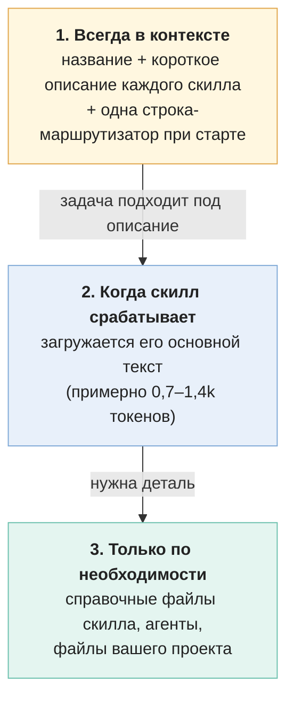

# ⚙️ Как это работает

[← На главную](../../README.ru.md) · [Быстрый старт](quickstart.md) · [Справочник по скиллам](skills.md) · **Как это работает** · [FAQ](faq.md)

Коротко о том, что происходит «под капотом»: когда что загружается, что пишет хук, откуда берутся ≈1,4k токенов и как пак проверяет сам себя.

## Три слоя



Так пак держит «постоянную стоимость» низкой: тяжёлое читается только тогда, когда нужно.

## Сколько это стоит в токенах

| Что | Сколько | Когда платите |
|---|---|---|
| Описания 17 скиллов + строка-маршрутизатор | **≈1,4k токенов** (оценка Claude Code) | В каждой сессии |
| Основной текст скилла | ≈0,7–1,4k токенов | Каждый раз, когда скилл срабатывает |
| Справочные файлы, агенты | зависит от задачи | Только когда нужны |
| Хуки | 0 токенов, они работают вне модели; но их вывод (одна короткая строка, заметка `Next:`) попадает в контекст | При старте сессии |

Проверить самому: `claude plugin details foma-skills`. Это оценки: фактический расход может немного отличаться.



> [!NOTE]
> Скиллы в паке нарочно короткие: у каждого есть потолок по токенам, который проверяется в CI. Подробнее о правилах: [`docs/lite-standard.md`](../lite-standard.md) (на английском).

## Что делает хук старта сессии

Один хук `SessionStart` (на запуске, после `/clear` и после автосжатия) печатает в контекст до трёх вещей:

1. **Строка-маршрутизатор** (≈55 токенов): «если подходящий скилл есть, вызови его первым; простые вопросы, пояснения и правки в одну строку скилла не требуют; вопросы про выбор модели для задач плана требуют».
2. **Заметка handoff:** строку `Next: …` из `.scratch/handoff.md`, если заметка свежая (моложе 24 часов) и сессия не после сжатия контекста.
3. **Прогресс плана:** например `Plan refunds: 2/5 tasks done.`, если в `docs/plans/` есть незавершённый план.

## Журнал срабатываний и приватность

Ещё два крошечных хука ведут локальный журнал `.scratch/fires.jsonl` **в вашем проекте**:

```json
{"t":"2026-11-13T09:00:00Z","event":"start","session":"…"}
{"t":"2026-11-13T09:02:10Z","skill":"foma-skills:planning","session":"…"}
```

- В журнале **нет текста ваших запросов**, только имя скилла, время (UTC) и id сессии.
- Наружу ничего не отправляется.
- Отключить: переменная окружения `FOMA_FIRE_LOG=off`. Сбросить: удалить файл.
- Зачем он: через 20+ сессий `/foma-skills:tuning` (и скилл `learning`) видят, какие скиллы вам ни разу не пригодились, и предлагают убрать их или переписать описание.

## Файлы, которые пак создаёт

Все записи происходят **после вашего «ок»**. Полная таблица путей: [быстрый старт](quickstart.md#куда-пак-кладёт-файлы).

## Помощники-агенты

`groundwork` копирует в `.claude/agents/` вашего проекта трёх помощников. Скиллы зовут их по короткому имени: `implementer`, `reviewer`, `explorer`. Подробности: [справочник](skills.md#помощники-агенты).

## Какие модели используются

Пак не привязан к одной модели. `planning` выбирает модель и усилие **на каждую задачу плана**: сложное на Opus, рутинное на Sonnet, Haiku только там, где результат подстрахован тестами. Ревью делает Opus один раз на фичу, разведка идёт на Haiku. Лимит вашей подписки это учитывает: дорогая модель берётся только там, где она нужна.

## Как пак проверяет сам себя

| Проверка | Что проверяет | Где |
|---|---|---|
| Статические проверки | Формат, длина описания (≤250 символов), потолки по токенам, ссылки | `scripts/check_skills.py`, в CI на каждый push |
| Тесты срабатывания | Скилл включается на нужных запросах и молчит на ненужных (Haiku, промахи перепроверяются на Sonnet) | `scripts/trigger_test.py`, наборы в `tests/triggers/` |
| Смоук-прогон | Реальная задача в тестовом проекте, результат проверяют скрипты и судья | `scripts/task_test.py`, задачи в `tests/tasks/` |
| Журнал провалов | Заменённые после провала запросы и переписанные чеклисты записаны открыто | [`research/test-ledger.md`](../../research/test-ledger.md) |

> [!IMPORTANT]
> Итоговое сравнение «с паком и без пака» ещё не проведено: версия **0.1.0 — пре-релиз**. Цифры из `research/` получены на небольших выборках.

## Где читать дальше

- Решения и их обоснования (на английском): [`research/decisions.md`](../../research/decisions.md)
- Живая карта связей скиллов: [открыть](https://t8jwscc7qy-sketch.github.io/foma-skills/graph.html) (исходник: [`docs/graph.html`](../graph.html)) · [диаграмма в README](../../README.ru.md#skills)
- Вопросы новичков: [FAQ](faq.md)
