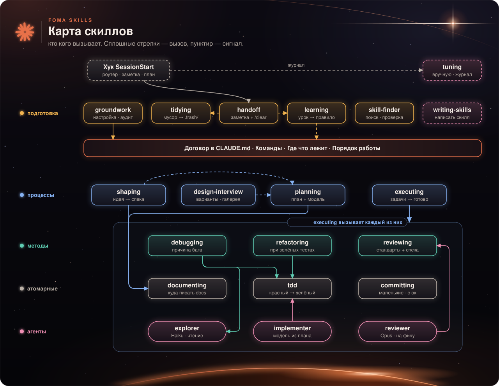

# 🧰 Справочник по скиллам

[← На главную](../../README.ru.md) · [Быстрый старт](quickstart.md) · **Справочник по скиллам** · [Как это работает](how-it-works.md) · [FAQ](faq.md)

Все 17 скиллов. Для каждого: когда срабатывает, что сказать, что делает, что меняет в проекте и чего не делает.

**Режим:** *авто* — срабатывает сам, когда задача подходит; *вручную* — вы вызываете его командой. Любой скилл можно вызвать и вручную: `/foma-skills:<имя>`.

**Содержание:** [🟠 Подготовка и поддержка](#-подготовка-и-поддержка) · [🔵 Идеи, дизайн и разработка](#-идеи-дизайн-и-разработка) · [🟢 Методы](#-методы) · [⚪ Атомарные](#-атомарные) · [🟣 Мета](#-мета)

---

## 🟠 Подготовка и поддержка

### `groundwork` — настройка проекта
- **Скажите:** «Настрой этот проект для работы с Claude», «проверь репозиторий».
- **Делает:** смотрит проект, проверяет безопасность (что не попадёт в git лишнее), создаёт короткий договор в `CLAUDE.md` (команды, где что лежит, порядок работы) и скелет `docs/`, кладёт помощников-агентов в `.claude/agents/`. Считает, сколько токенов проект тратит на старте сессии.
- **Меняет:** `CLAUDE.md`, `docs/`, `.gitignore`, `.claude/agents/`, **только после вашего «ок»**. Уже существующих агентов не перезаписывает.
- **Не делает:** не трогает ваш личный `~/.claude/CLAUDE.md`.

### `tidying` — уборка
- **Скажите:** «В репозитории бардак, убери лишнее».
- **Делает:** ищет мусор по уровням: **T1** — безопасно удалять (копии `.bak`, временные файлы); **T2** — «сначала посмотреть» (похоже на мусор, но нужен второй признак и ваше решение по каждому файлу); **T3** — **никогда** (`.env`, ключи, базы и данные, сохранения игр, `assets/`, lock-файлы, исходники, не подпадающие под T1). Показывает отчёт, спрашивает «ок» по группам.
- **Меняет:** отслеживаемые файлы удаляет через `git rm`, неотслеживаемые переносит в `.trash/<дата>/` с описью `MANIFEST`: всё можно вернуть.
- **Не делает:** никогда не запускает `rm -rf` и `git clean`; в папке без git останавливается и ничего не двигает.

### `learning` — уроки сессии
- **Скажите:** «Ты постоянно делаешь X, сделай правило», «почисти CLAUDE.md».
- **Делает:** берёт конкретное событие (вы поправили Claude, ошибка повторилась) и выбирает **самый маленький** слой исправления: ничего → строка в `CLAUDE.md` → правило в `.claude/rules/` → запрет `permissions.deny` или хук → проект-скилл. Заодно вычищает устаревшие правила (старше 90 дней, указывают на несуществующее). Показывает не больше 3 предложений с точным изменением.
- **Меняет:** только одобренные вами пункты. Новые строки получают дату `(ГГГГ-ММ-ДД)`, чтобы потом проверить их актуальность.
- **Не делает:** не правит файлы самого пака (обновление плагина всё равно их перезапишет); не пишет «общие советы» без события.
- **Бонус:** если есть журнал `.scratch/fires.jsonl` на 20+ сессий, предложит отключить скиллы, которые ни разу не сработали.

### `skill-finder` — поиск чужих скиллов
- **Скажите:** «Есть скилл для release notes?», «безопасно ли ставить этот скилл?».
- **Делает:** сначала проверяет, не покрыто ли это уже, ищет, оставляет до 3 кандидатов, **читает каждый файл** кандидата (через агента только для чтения) на закреплённой версии, выносит вердикт.
- **Меняет:** копирует скилл в `.claude/skills/` только после вашего «ок» и записывает решение в `docs/decisions.md`.
- **Не делает:** никогда не запускает чужие скрипты и не передаёт `-y`.

### `handoff` — заметка на следующую сессию
- **Скажите:** «Завершаем, продолжу завтра», «давай начнём новую сессию».
- **Делает:** пишет `.scratch/handoff.md` (до 20 строк, первая строка `Next:` — что делать дальше), отмечает мусор для `tidying` и уроки для `learning`.
- **Дальше:** при старте следующей сессии хук покажет строку `Next:`, если заметке меньше 24 часов (после автосжатия контекста не показывает, контекст и так цел).
- **Не делает:** не коммитит и не очищает контекст сам: подсказывает выполнить `/clear`.

---

## 🔵 Идеи, дизайн и разработка

### `shaping` — из идеи в спеку
- **Скажите:** «Хочу сделать систему бонусных баллов».
- **Делает:** читает код, пересказывает проблему своими словами, задаёт вопросы про конкретные случаи, пока идея не станет понятной.
- **Меняет:** после вашего утверждения пишет `docs/specs/<имя>.md`.
- **Не делает:** не пишет код. Для мелкой правки вопросов не задаёт и выходит.

### `design-interview` — выбор внешнего вида
- **Скажите:** «Нужен новый вид экрана настроек», «хочу другой стиль».
- **Делает:** сначала спрашивает про задачу и то, чего вы не хотите; затем три разных агента рисуют три разных варианта (безопасный, смелый, странный). Варианты открываются рядом в браузере на трёх ширинах (375, 768, 1440), можно смешать части разных вариантов. Для игр есть режим играбельных прототипов.
- **Меняет:** `docs/design/<фича>/` и `DESIGN.md` с вашим выбором.
- **Не делает:** не подменяет готовую дизайн-систему проекта.

### `planning` — план
- **Скажите:** «Составь план для фичи возвратов», «какую модель взять на задачу T2?».
- **Делает:** для мелкой правки говорит «просто делаем». Для многошаговой работы пишет `docs/plans/<фича>/plan.md`: упорядоченные задачи (`## T1`, `## T2`…), у каждой условие «Done when» с командой проверки и строка `Model:` (Opus для сложного, Sonnet для рутины, Haiku только там, где есть тесты). В плане можно задать «аппетит»: сколько времени вы готовы потратить.
- **Меняет:** только файлы плана.

### `executing` — выполнение плана
- **Скажите:** «Выполняй план», «продолжи план с T2».
- **Делает:** идёт по задачам, 1–2 задачи делает сам, больше — через агентов `implementer` с моделью из плана. После каждой проверяет «Done when». В конце одно ревью всего изменения. Если план давно перерос «аппетит», останавливается и предлагает: урезать, продлить или продолжить.
- **Меняет:** код и статусы в плане; завершённый план уходит в `docs/plans/archive/`.

---

## 🟢 Методы

### `debugging` — поиск причины бага
- **Скажите:** «Почему падает оформление заказа?», «выясни, почему тормозит».
- **Делает:** строит способ быстро воспроизводить, формулирует гипотезы, находит **первопричину**, только потом чинит и добавляет регрессионный тест. Отладочные строки помечает `[DEBUG-xxxx]`, чтобы потом убрать.
- **Не делает:** не гадает: не чинит, пока не нашёл причину.

### `reviewing` — ревью
- **Скажите:** «Проверь мою ветку, можно мёржить?».
- **Делает:** смотрит изменение по двум осям (стандарты проекта и спека), для интерфейса есть свой список. Итог коротко: **можно выпускать** или **сначала исправить**, с приоритетами.
- **Не делает:** не правит код сам, это заметки.

### `refactoring` — рефакторинг
- **Скажите:** «Отрефактори report.py, убери дублирование».
- **Делает:** сначала запускает тесты (должны быть зелёные), меняет структуру, но **не поведение**, и сверяет результат. Замеченное по пути не чинит молча, а сообщает.

---

## ⚪ Атомарные

### `tdd` — сначала тест
- **Скажите:** «Добавь правило скидки сначала с тестом», «сделай через TDD».
- **Делает:** «красный — зелёный» вертикальными срезами: один тест, минимум кода, следующий. Ожидаемые значения берёт независимо от реализации.

### `committing` — коммиты
- **Скажите:** «Закоммить мои изменения».
- **Делает:** маленькие коммиты в стиле вашего проекта (берёт стиль из `CLAUDE.md` и истории), добавляет файлы **по путям**, а не `git add -A`. Секреты вроде `.env` оставляет за бортом и говорит об этом. Останавливается, если в индексе остались строки `[DEBUG-…]`.
- **Не делает:** **никогда не пушит сам.**

### `documenting` — документация
- **Скажите:** «Запиши решение использовать Decimal», «обнови README».
- **Делает:** кладёт документацию туда, где ей место, а записи о решениях (`docs/decisions.md`) заводит только для неочевидного: если решение видно из кода, записи не будет.
- **Не делает:** не трогает комментарии в коде и сообщения коммитов; правку в одну строку делает без скилла.

---

## 🟣 Мета

### `writing-skills` — написать свой скилл
- **Скажите:** «Напиши скилл для нашего процесса релиза», «скилл не срабатывает».
- **Делает:** сначала проверяет, нужен ли вообще скилл (может хватить строки в `CLAUDE.md` или хука), пишет короткое описание до 250 символов с «Use when», держит тело в 300–800 токенов, предлагает проверку: 5 запросов, которые должны включать скилл, и 5, которые не должны.

### `tuning` — настройка пака по фактам *(вручную)*
- **Вызов:** `/foma-skills:tuning`
- **Делает:** бесплатный скрипт читает журнал `.scratch/fires.jsonl` и сохранённые прогоны тестов и находит скиллы, которые ни разу не срабатывали (при журнале от 20 сессий) или падают. Модель разбирает не больше 3, ставит диагноз и предлагает **минимальную** правку: описание, одну строку, отключить или удалить.
- **Меняет:** ничего без вашего «ок». В репозитории самого пака дополнительно проверяет правку тестами; в вашем проекте файлы пака только читаются (обновление их перезапишет), поэтому предлагает отключить скилл, строку в `CLAUDE.md` или текст issue.
- **Бюджет запуска:** не больше 3 скиллов, 30 запросов Haiku и 2 смоука Sonnet, дальше спрашивает.

---

## Помощники-агенты

`groundwork` кладёт их копии в `.claude/agents/` вашего проекта. Скиллы зовут их по короткому имени.

| Агент | Модель | Что делает |
|---|---|---|
| `implementer` | та, что указана в плане для задачи | Пишет код, одну задачу за вызов |
| `reviewer` | Opus | Ревью один раз на фичу |
| `explorer` | Haiku, только чтение | Ищет и читает файлы, возвращает короткую сводку (до 10 строк) |
